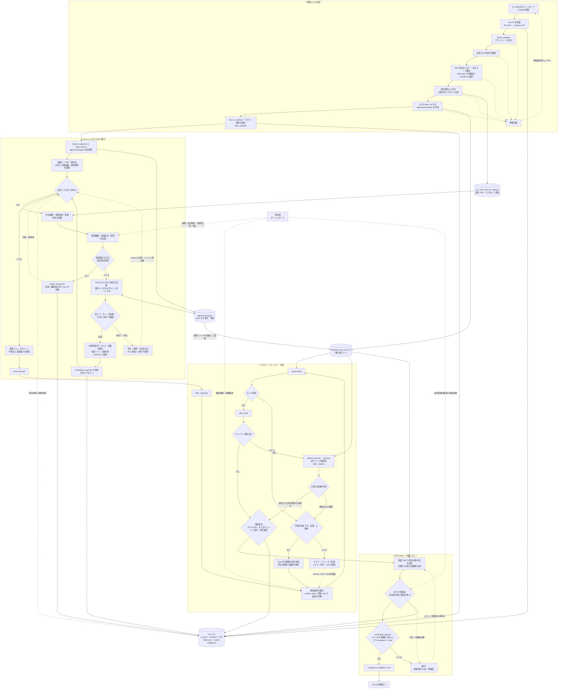
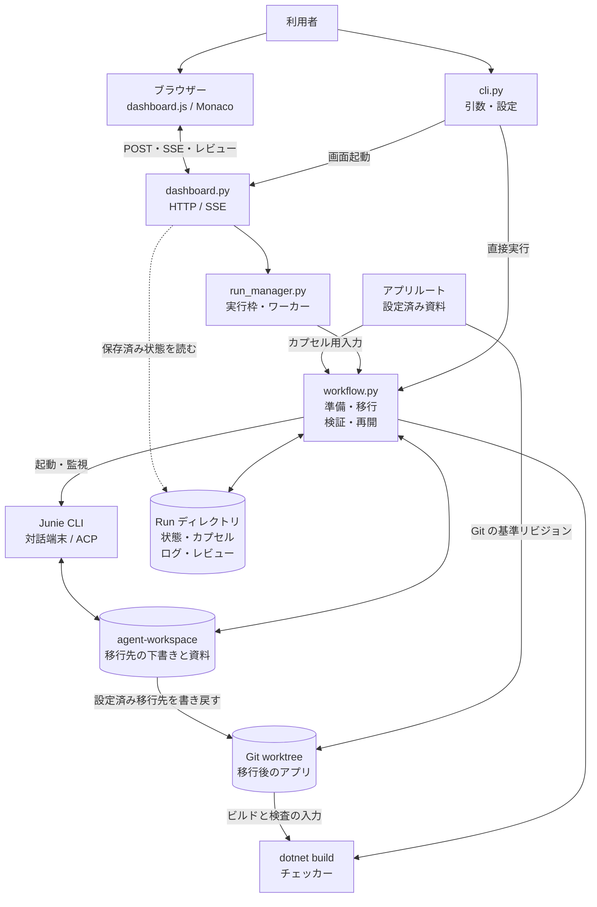
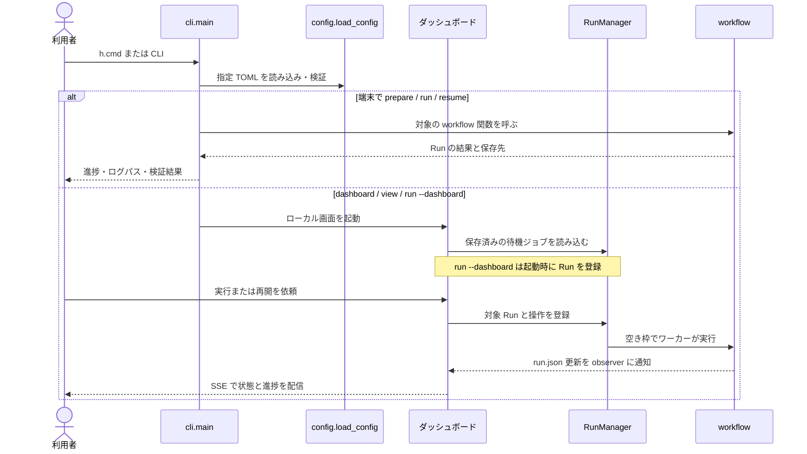
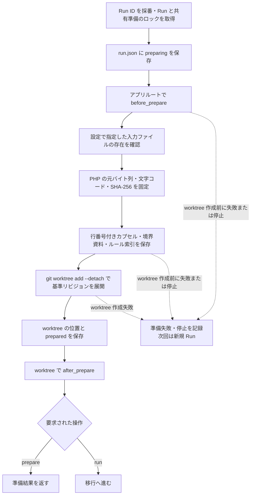
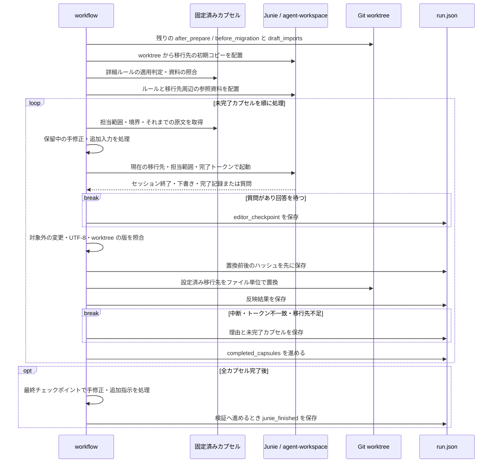
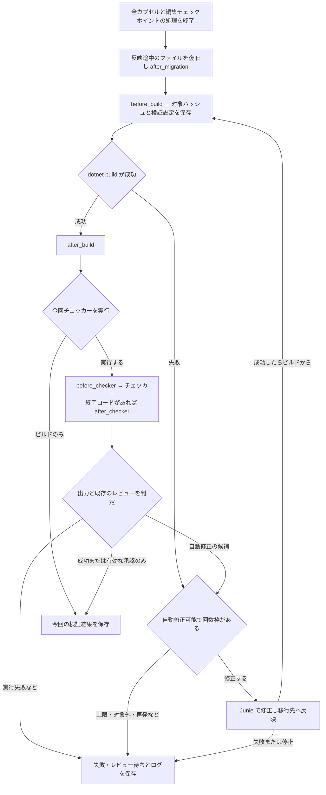
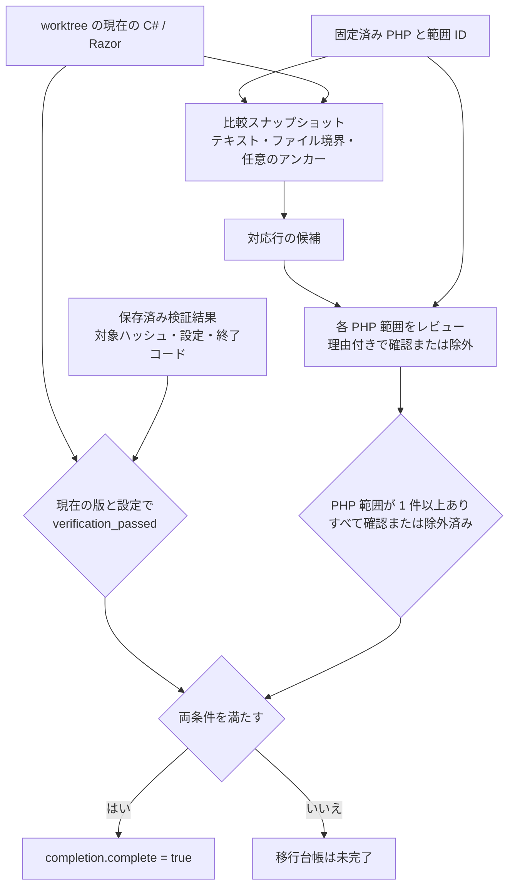
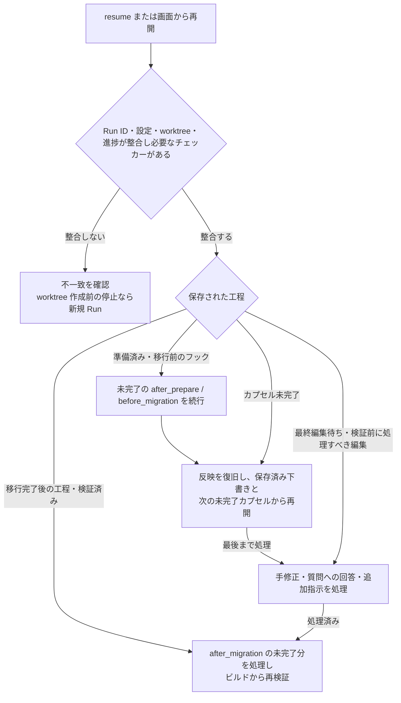

# PHP → C# 移行ハーネスのアーキテクチャ

Python のハーネスが入力の固定、実行順序、ファイル反映、検証、再開を管理します。Junie CLI はハーネスが用意した作業領域で C#／Razor を生成・修正し、.NET SDK と任意のチェッカーは別の Git worktree で動きます。添付の構成図を起点に、現在の実装の呼び出し順と保存境界を示します。設定項目の一覧は [技術仕様](../SPEC.md)、並行処理の契約は [Run の状態とロック契約](run-state-contracts.md) を参照してください。

## 全処理順を一枚で見る

この図は新規 `run` の通常経路を左から右へ示し、失敗後の再開先と完了判定を同じ図にまとめています。設定によって存在しないフックやチェッカーはスキップされます。レビューと修正の反復、ダッシュボードからの人の介入、保存状態からの再開は下段の分岐を参照してください。

## 1. コンポーネントと作業領域

| 領域 | 内容と読み書きの主体 |
| --- | --- |
| アプリルート `project.root` | PHP や資料の読み取り元、`before_prepare` の実行場所、Git worktree の作成元。PHP は準備時点のファイルを読み、worktree の初期状態は `base_ref`（既定は `HEAD`）のコミットから取得します。 |
| `<run_root>/<Run ID>/` | ハーネスがカプセル、状態、編集キュー、ログ、比較スナップショットを保存します。 |
| `<run_root>/<Run ID>/agent-workspace/` | Junie に渡す移行先のコピー、固定資料、境界抜粋、作業用ファイルを置きます。 |
| `<worktree_root>/<Run ID>/` | detached worktree。ハーネスが移行先を反映し、フック、ビルド、チェッカーがこのアプリを参照します。 |

`run_root` と `worktree_root` はアプリルートの外に置き、互いに包含しない構成です。TOML から見たプロジェクトパスと、移行入力・移行先の基準の違いは [config.py](../src/migration_harness/config.py) の `load_config` に集約されています。設定の解釈はプロジェクトのパス、実行ツール、移行単位の順です。旧形式の共通資料は全移行単位から集めてから適用します。設定画面は `settings_form.py` でフォームの値を TOML の型に変換し、空欄で継承に戻す場合と、空配列を明示する場合を区別します。 Junie は起動ユーザーの OS 権限で動き、モデルサービスへ移行コンテキストが送られます。作業領域内に限定する指示と書き戻し前の照合が、ハーネス側のファイル反映の境界です。実行するフックやチェッカーの動作はその設定に従います。

## 2. 起動からワークフローへの入口

- Windows の `h.cmd` は隣接する仮想環境の `php-to-csharp-harness.exe` と `harness.local.toml` を使います。Python のエントリーポイントは `migration_harness.cli:main` です。初回の `dashboard` は指定 TOML がなくても設定画面を開けます。保存操作で内容を検証し、読み込み時の版と照合して置き換えます。 `view` と `resume --dashboard` は保存済み Run を開き、再開の実行は画面から指示します。 [h.cmd](../h.cmd) · [cli.py](../src/migration_harness/cli.py) · [dashboard.py](../src/migration_harness/dashboard.py)
- サーバーは `127.0.0.1` の空きポートにバインドし、ランダムな URL 接頭辞を使います。GET は Host と接頭辞、POST は Host と Origin を照合します。`GET …/events` は Run 別の連番付き SSE を配信し、再接続時は `Last-Event-ID` より後の直近保持分（最大 100 件）を返します。 [dashboard.py](../src/migration_harness/dashboard.py)
- `RunManager` が操作 ID を付けて FIFO キューに登録し、最大 5 件を別スレッドで実行します。同じ移行単位の実行中・待機中の重複を拒否します。`<run_root>/dashboard-queue.json` から未起動のジョブを復元し、起動済みの工程は繰り返さず保存状態を表示します。Junieの終了未確認が解消されるまでは同じRunの会話依頼を保留し、その理由を再起動後も復元します。ワーカーが使う設定は実行枠へ入る際にコピーします。 [run_manager.py](../src/migration_harness/run_manager.py) · [junie_conversation.py](../src/migration_harness/junie_conversation.py)

## 3. 準備とカプセルの固定

1. `prepare_run` と `run_with_junie` は、Run 単位のロックを取ってから同じ `run_root` の共有準備ロックを取ります。準備が終わると共有ロックを解放し、`run_with_junie` は Run ロックを保持して移行と検証へ進みます。新規 `run` は準備前に Junie を起動できる条件も確認します。 [workflow.py](../src/migration_harness/workflow.py) · [run_records.py](../src/migration_harness/run_records.py)
2. `prepare_context` は PHP のコピーを `capsule/php-sources/` に保存し、以降の分割と比較の基準にします。文字コードの `auto` は UTF-8 BOM を優先し、UTF-8 と EUC-JP で厳密に検査します。異なる解釈が成立する場合は明示指定が必要です。原文の改行を保った行番号付き Markdown を作り、見出しと共通入力も含む `max_context_chars`（既定 500,000、最小 1,000）を適用します。 [capsules.py](../src/migration_harness/capsules.py)
3. 分割位置は原文の行と文字位置で決まります。1 行が上限に収まらない場合は、移行を担当する文字範囲と、その前後の参照範囲を記録します。同じ入力の隣接カプセルは各方向最大 12 行の境界抜粋を別ファイルに持ちます。 `manifest.json` にファイル・行範囲・文字範囲および保存物のハッシュを記録します。必須ルール・詳細ルール・共通の参考実装はカプセル本文と別に保存します。 [capsules.py](../src/migration_harness/capsules.py) · [rule_materials.py](../src/migration_harness/rule_materials.py)
4. worktree の作成に成功すると移行先、カプセル数、Junie のモデル・推論の強さ・最大ステップ数を Run に保存します。`after_prepare` の中断・失敗は worktree があるため同じ Run で再試行できます。中断した対象フックは、成功済みコマンドのうち先頭から一致する分を省略します。 [workflow.py](../src/migration_harness/workflow.py)

## 4. Junie への資料配置・カプセル処理・反映

### Junie が読む内容

- 初回の作業領域作成前に `before_migration` と単位別の `draft_imports` を実行します。初回編集前に詳細ルールの説明を全移行範囲と照合し、判定に詳細本文が必要な場合はハッシュを検証して読ませます。全件の ID・適用可否・理由を検証して `detail_applicability` に保存します。毎回必須のルールは本文を渡し、適用対象と移行先が明記された詳細の原文や、参考実装の索引を作業領域に配置します。 [workflow.py](../src/migration_harness/workflow.py) · [rule_materials.py](../src/migration_harness/rule_materials.py)
- 移行先周辺の参照は、移行先の親、親と同階層の `inc`、その上の階層にある `Libs`・`Extensions` を起点に収集します。フック実行後の worktree から `capsule/target-context/` に初回固定し、以降はハッシュを照合して復元します。 [source_context.py](../src/migration_harness/source_context.py)
- カプセルごとに `.migration-context.md`、必要なら `.migration-boundary.md`、分割時は処理中の区間までの担当原文を渡します。境界資料は前後関係の参照用です。最終区間では関数をまたいだ分割箇所も原文と合わせて照合するよう指示します。Junie に指示する検証はソースの静的確認で、ビルドと設定済みの外部チェッカーは後段でハーネスが実行します。 [workflow.py](../src/migration_harness/workflow.py) · [php_literals.py](../src/migration_harness/php_literals.py)

### プロセスと成果物の受け渡し

| 経路 | 振る舞い |
| --- | --- |
| 端末での移行 | 端末の対話 CLI を使います。セッションを監視し、完了ファイルとプロセスの状態を確認します。 |
| ダッシュボードでの移行 | ACP（Agent Communication Protocol）を標準入出力で使用します。`initialize` → `session/new` → `session/prompt` と進み、`session/update` を処理し、許可要求への回答を画面から受け付けます。ACP でモデルが利用できない場合は、対応 CLI と利用者の承認があれば `--task` で今回の呼び出しを再試行します。 |
| 通信失敗と停止 | モデル通信に失敗すると、同じ作業領域と完了トークンで 1 秒、3 秒の間隔を置いて最大 2 回再試行します。停止境界ではプロセス群の終了を確認します。終了を確認できない場合は `JunieStopError` で止まり、利用者による残存プロセスの確認が必要です。 |

実装は [junie_cli.py](../src/migration_harness/junie_cli.py)、子プロセスや Windows の Job Object は [junie_process.py](../src/migration_harness/junie_process.py) と [windows_job.py](../src/migration_harness/windows_job.py) を参照してください。

`migration-complete-<token>.txt` の内容と全移行先の存在を照合してから完了数を増やします。終了コードは診断情報として記録します。トークン未発行や停止時も、対象外変更や版の照合を通過した下書きは保存される場合があります。オペレーターへの質問を保存する経路では、回答を待つチェックポイントに入ります。 [workflow.py](../src/migration_harness/workflow.py)

`apply_agent_targets` は作業中に worktree が変更されていないかを確認し、Junie 出力を UTF-8 として検証して BOM 付きにそろえます。変更ファイルの旧・新 SHA-256 を `target_apply_pending` に先に保存し、同じディレクトリ内の一時ファイルから 1 ファイルずつ置換します。復旧時に worktree が新ハッシュなら適用済み、旧ハッシュかつ Junie 側が新ハッシュなら再適用できます。それ以外の外部変更があれば停止します。 [worktree_targets.py](../src/migration_harness/worktree_targets.py)

### ブラウザーからの介入

エディタは対象ファイルの版を照合して保存します。移行中の手修正は `editor.json` に保留でき、区間の境目で元の版・手修正・現行版を照合して合流します。同じ箇所が競合すると `editor_checkpoint` で止まります。ACP の実行中に届けられる追加指示はセッションへの追加入力を試み、それ以外の保留指示は区間の境目や最後のチェックポイントで扱います。 [dashboard.py](../src/migration_harness/dashboard.py) · [editor_queue.py](../src/migration_harness/editor_queue.py) · [junie_cli.py](../src/migration_harness/junie_cli.py)

Junie の会話欄からの照会・再ビルド・チェッカー依頼は `junie_conversation.py` が Run ごとの状態と対象版に結び付けます。「いまのビルドの後で」のような依頼は先行する操作 ID と通常終了記録を照合してから後続処理を開始します。ビルドのみを依頼したときも、Run に設定されていたチェッカーの要件は検証記録に残ります。 [junie_conversation.py](../src/migration_harness/junie_conversation.py) · [Run の状態とロック契約](run-state-contracts.md)

## 5. ビルド・チェッカー・自動修正

- `_run_verification` は `after_migration` の後、ループのたびに `before_build` を実行して対象版を固定し、`dotnet build` を実行します。成功時だけ `after_build` へ進みます。フック失敗はその時点で止まり、`script_phase` とログを残します。チェッカーの優先順位は CLI の `--checker-command`、移行単位の設定、共通設定の順です。コマンドの `{worktree}`・`{build_project}`・`{target}` は該当する worktree のパスへ展開されます。 [workflow.py](../src/migration_harness/workflow.py) · [config.py](../src/migration_harness/config.py) · [command_paths.py](../src/migration_harness/command_paths.py)
- 通常の検証ループでは、保留中の手修正と待機中の追加指示が両方ある場合、ビルド前に `followup_only` で編集処理へ戻ります。画面から明示的に検証を依頼する経路では、依頼にひも付けた移行先の版を照合して実行します。 [workflow.py](../src/migration_harness/workflow.py) · [junie_conversation.py](../src/migration_harness/junie_conversation.py)
- チェッカーの成功は、終了コード 0 かつ無出力（UTF-8 として読んだ内容が BOM や空白のみの場合も含む）、または非負の終了コードで標準出力・標準エラーを連結した応答全体が `特に気になる点はありません。` の場合です。明示的な成功応答は UTF-8 の BOM と前後の空白を許容します。その他の出力は終了コードが 0 でも指摘の扱いを判定します。承認には指摘 ID、理由、該当ファイルのハッシュを保存し、再検証で有効な承認済み指摘だけが残ったとき `checker_accepted` になります。 [checker_output.py](../src/migration_harness/checker_output.py) · [workflow.py](../src/migration_harness/workflow.py)
- ビルドとチェッカーの自動修正は Run 単位の `max_repair_attempts` を共有します。既定は 2、0 は無効です。対象外の指摘、修正後の診断の再発、回数や出力サイズの上限などで停止します。チェッカー出力は最大 65,536 バイト、抽出済み診断を渡す経路は合計 8,000 文字が上限です。形式が混在して全文を渡す場合は空白を正規化した全文で再発を判定します。Junie の起動失敗・モデル通信失敗・中断は自動修正回数を消費しません。ビルドは設定済み移行先にひも付くコンパイラ診断を修正に渡します。Razor の生成コードに同じモデル型エラーが出る場合は、条件を満たす重複だけを除外し、編集可能なページ側を修正します。修正前のログと履歴は Run に残ります。 [workflow.py](../src/migration_harness/workflow.py)

## 6. レビューと移行完了の判定

1. Diff Viewer は固定済み PHP と取得時点の移行先を比較します。通常の比較スナップショットは worktree を使い、移行実行中のライブ比較では条件に応じて Junie の下書きを使います。固定比較は `review-snapshots/<ID>.json` に保存します。Junie のアンカー生成では対応行の座標を検証し、比較スナップショットと対象ハッシュにひも付く対応候補を記録します。固定済み PHP を持たない旧 Run は manifest の入力パスの現行ファイルを読みます。 [diff_viewer.py](../src/migration_harness/diff_viewer.py) · [review_anchors.py](../src/migration_harness/review_anchors.py)
2. 移行台帳の公開範囲 ID は `カプセル番号:カプセル内の範囲番号`（例 `1:1`）です。Diff Viewer で内容を確認し、CLI の `ledger-review` で `confirmed`・`excluded`・`needs_review` と理由を記録します。確認をひも付けた対象版や対応範囲が変わると `stale` として再確認を求めます。 [cli.py](../src/migration_harness/cli.py) · [workflow.py](../src/migration_harness/workflow.py)
3. `verification_passed` には、反映保留がないこと、全カプセル完了、ビルド成功、必要なチェッカーの成功または有効な承認、検証フックの成功、対象ハッシュと設定の一致が必要です。照合する設定はビルド先、チェッカーコマンド、検証フックです。`completion.complete` はこれに加えて、PHP 範囲が 1 件以上あり、全件に有効な確認または理由付き除外がある場合に成立します。 [workflow.py](../src/migration_harness/workflow.py)

`run.json` の `build_succeeded`、`checker_succeeded`、`checker_accepted` は検証工程の状態です。移行の完了判定は台帳を参照してください。ハーネスが再照合する範囲は移行先と上記の設定です。依存ソースやコマンド実体を変更した場合は再検証が必要です。実行時の振る舞いを検証するテストは、プロジェクトのフックやチェッカーで指定できます。 [技術仕様](../SPEC.md)

## 7. 停止・失敗後にどこから再開するか

`load_saved_run` は Run の UUID、アプリルート、移行単位、移行先と worktree の位置を現行設定と照合します。 `_resume_with_junie` は保存されたカプセルパスと完了数を照合します。移行中の通常再開では worktree の移行先ハッシュを比較し、前回の Junie 下書きと固定資料を使って `completed_capsules + 1` から進めます。検証工程からの通常再開は、チェッカーだけが残っている場合もビルドから行います。 `after_prepare`、`before_migration`、`after_migration` は完了済みの工程を省略します。工程の途中から再開する場合は、保存済みのコマンド列と先頭から一致する成功分を省略します。 [run_records.py](../src/migration_harness/run_records.py) · [workflow.py](../src/migration_harness/workflow.py)

| 状況 | 確認する記録と再開条件 |
| --- | --- |
| worktree 作成前の停止・失敗 | `preparation_interrupted` / `preparation_failed` と `before_prepare.log` などを確認し、新規 Run で準備します。 |
| 設定スクリプトの失敗 | `script_phase`、終了情報、工程ログから失敗したコマンドを確認します。worktree 作成済みなら該当工程を再開できます。 |
| Junie の中断・編集待ち | `current_capsule`、`completed_capsules`、`operator_question`、`editor.json` と移行先の版を確認します。終了未確認のエラーでは先に残存プロセスの終了を確認します。 |
| ビルド・チェッカー失敗 | `build.log` または `checker.log`、`repair_history` と理由を確認します。チェッカーを必要とする Run は再開時にもチェッカーの設定が必要です。 |
| 一部のファイル反映後に停止 | `target_apply_pending` の旧・新ハッシュと現物を照合して、未反映分を復旧します。外部更新によりどちらの版にも一致しない場合は内容の照合が必要です。 |

## 8. 保存データと並行処理の境界

| 保存先 | 調べられること |
| --- | --- |
| `<run_root>/dashboard-queue.json` | ダッシュボードの待機・起動済みジョブと操作 ID、会話依頼の取消記録。 |
| `<Run ID>/run.json` | 工程、モデル設定、進捗、対象版、修正・検証・レビュー履歴、工程時間と Junie の使用量。 |
| `<Run ID>/capsule/` | `manifest.json`、分割本文・境界資料、固定済み PHP・ルール・参考実装、移行先周辺の固定資料。 |
| `<Run ID>/agent-workspace/` | Junie の現在の下書き、資料、完了記録、一時ファイル。 |
| `<Run ID>/editor.json` | 保留中の編集、操作した差分、追加入力や会話の履歴。 |
| `<Run ID>/build.log`、`checker.log`、`<工程>.log` | 工程の出力。修正の前に診断を別ログへ退避する経路もあります。 |
| `<Run ID>/review-snapshots/<ID>.json` | PHP と移行先の固定コピー、ファイル境界、任意の行アンカー。 |

Run 単位の OS ロックは同じ保存先を使う別 CLI との実行競合を防ぎます。 `run.lock` と `editor.lock` は個々の JSON の更新を保護し、一時ファイルから置換します。工程の observer は `run.lock` 解放後にダッシュボードへ通知します。worktree の編集・反映を直列化するメモリロックは同一プロセスで有効で、別プロセスからの更新とは保存したハッシュで照合します。 [run_records.py](../src/migration_harness/run_records.py) · [editor_queue.py](../src/migration_harness/editor_queue.py) · [worktree_targets.py](../src/migration_harness/worktree_targets.py) · [Run の状態とロック契約](run-state-contracts.md)

実行経路の回帰例は [移行サイクル](../tests/test_migration_cycle.py)、[移行台帳](../tests/test_migration_ledger.py)、[並列 Run](../tests/test_parallel_dashboard.py)、[Junie 会話](../tests/test_junie_conversation.py)、[プロセス停止](../tests/test_junie_process.py) にあります。評価用アプリと結果は [evaluations](../evaluations/) にあります。

## ダッシュボードの回帰テスト

`PYTHONPATH=tests python -m unittest test_editor_run_isolation test_settings_browser` でダッシュボードの検証を実行します。Node テストは配布する `dashboard.js` と `dashboard_editor.js` を VM で読み込み、Run 切り替え後の HTTP・SSE 応答と編集内容を確認します。設定画面の Chromium テストは本番と共通の `render_dashboard_html()` と HTTP ハンドラーを通り、TOML の保存結果を確認します。

保存済み Run が必要なテストでは `tests/fixtures.py` の `SavedRunFixture` を使います。会話テストでは検証したい順序を Event や RunManager の Condition で待ち、期限は異常検出に使います。背景スレッドの例外を主スレッドで再送出し、ワーカーを保留するテストでは Event の解放と終了待ちを mock の解除前に行います。

CI では Windows・Ubuntu の Python 3.11／3.13 で、Node.js 22 とランナーにある Chromium／Chrome／Edge を使います。設定の Chromium テストは DevTools 接続時にブラウザのバージョンを記録します。 `python tests/run_shard.py full --require-ui` でローカルでも同じ必須条件を有効にできます。設定の保存・再読込、エディタの Run 分離、並行 Run デモの3件が成功して初めて必須条件を満たします。通常の unittest 実行では、ローカルの依存不足は理由付きで skip になります。

Windows の回帰テストは `conversation-editor`（会話と HTTP エディタ）および `remaining` に分けています。新しいテストは自動検出され、各 ID がどちらか一方に入ることを確認します。Ubuntu は全件実行します。ジョブの `TEST_TIME` 行はテスト ID と実行時間を表します。手元では `python tests/run_shard.py full --timings` で時間を取得できます。分割を調整するときは Python・OS ごとの ID 集合、skip 理由、最長ジョブの実測を比較し、workflow の集約条件と `.github/codex/issue.py` のジョブ名も更新します。

ダッシュボードの `Dashboard.server()` はループバックに接続し、`_dashboard_handler()` が GET の配信と POST の共通検証を担当します。POST は本文の形式と操作ごとのサイズを確認し、対象 Run を確定した後に設定、編集・会話、追加指示、比較、実行制御へ振り分けます。
